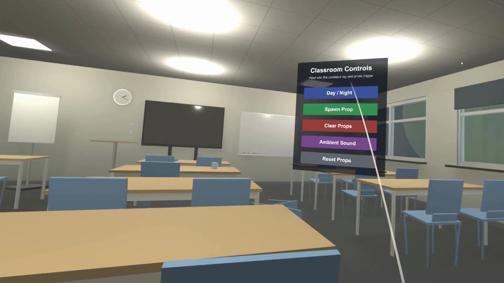
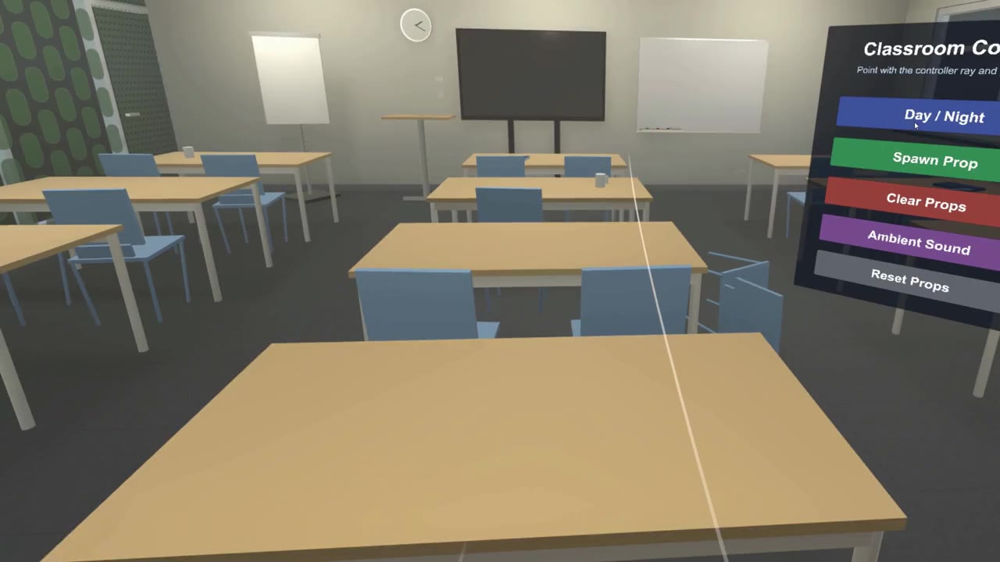
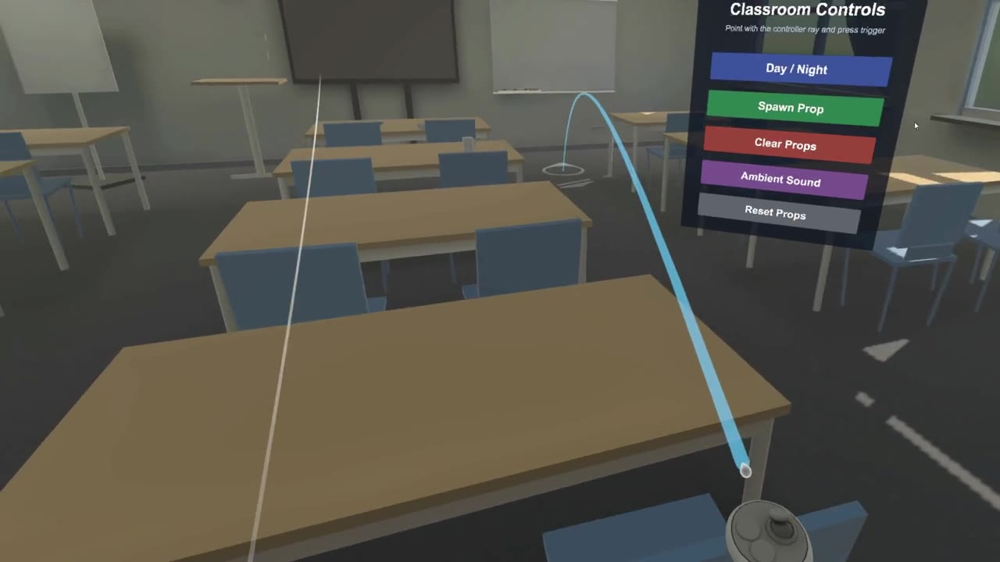

# VR Classroom Digital Twin

A virtual reality digital twin of a real classroom, built in Unity. You can walk around the room, pick up and throw objects, switch between day and night, and control the space from a floating control panel.

Built as the individual assignment ("The Interactive Public Space") for the Extended Reality course in the Applied Data Science & AI program at Zuyd University of Applied Sciences.

  
  

## Features

- **Digital twin of a real room**: desks, chairs, screens, whiteboards, windows and materials modelled on reference photos of the actual classroom, with baked lighting and reflection probes.
- **Grab and throw**: markers, mugs, notebooks and erasers are physics objects you can pick up with the controllers or your hands (XR Interaction Toolkit, XR Hands).
- **Classroom Controls panel**: a world-space UI you point at with the controller ray:
  - **Day / Night** switches the sun, sky and ambient light and turns the ceiling lights on at night
  - **Spawn Prop / Clear Props** adds props at a spawn point (capped at 15, oldest removed first) or removes them
  - **Ambient Sound** toggles looping classroom ambience
  - **Reset Props** puts every prop back where it started
- **Self-healing props**: anything that falls out of the world returns to its start position automatically.

## My scripts

All in `Assets/Scripts/`:

| Script | What it does |
|---|---|
| `EnvironmentController.cs` | Day/night toggle: sun intensity and colour, skybox, ambient intensity, ceiling lights |
| `PropSpawner.cs` | Spawns props in rotation at a random offset around a spawn point, with a maximum count |
| `PropResetter.cs` | Stores a prop's start pose and resets it when it falls below a height limit |
| `ResetAllProps.cs` | Resets every prop in the scene from one button |
| `AmbientAudioController.cs` | Starts and stops the looping ambient audio |

## Tech stack

Unity 6 (6000.6), C#, Universal Render Pipeline, XR Interaction Toolkit, XR Hands, OpenXR (Meta Quest / Android XR)

## How to open

1. Clone the repository and open the folder in Unity Hub with Unity 6000.6 or newer.
2. Open `Assets/Scenes/Classroom.unity`.
3. Press Play with a headset connected through OpenXR, or use the XR Device Simulator to try it with mouse and keyboard.

My own assets live in `Assets/Scripts`, `Assets/Prefabs`, `Assets/Materials`, `Assets/Textures`, `Assets/Audio` and `Assets/Scenes/Classroom`. The rest is Unity's VR template and XR Interaction Toolkit samples.
